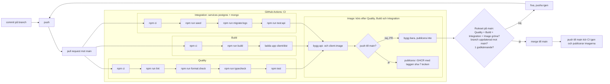

# Pipeline Docs

## Ruleset på main

Rulesetet heter `main` och ligger under _Settings → Rules → Rulesets_.

| Inställning | Värde |
| --- | --- |
| Enforcement status | **Active** |
| Target | Default branch (`main`) |
| Bypass list | Tom – reglerna gäller även admins |

Regler:

- **Restrict deletions** – `main` kan inte raderas.
- **Block force pushes** – ingen kan skriva om historiken på `main`.
- **Require a pull request before merging**
  - Minst **1** godkännande krävs, så ingen kan merga sin egen PR ensam.
  - Tillåtna merge-metoder: merge och squash.
- **Require status checks to pass**
  - Kräver: **`Quality`**, **`Build`**, **`Integration`** och **`Image`** från GitHub Actions.
    Namnen är jobbens `name:` i `.github/workflows/ci.yml`. `Integration` lades till i M5.
  - Kontrollerat 2026-10-27 med `gh api repos/andreasjosef/utpost/rulesets/23657261`:

    ```
    enforcement=active bypass=0
    strict=true checks=Quality, Build, Integration, Image
    approvals=1
    ```

    På PR #71 visar `gh pr checks 71 --required` alla fyra som required och gröna.

  - **Require branches to be up to date before merging** är på – branchen måste
    vara uppdaterad mot `main` innan merge.

## CI flödesdiagram


## Vad varje steg fångar

| Steg | Jobb | Kommando | Fångar |
| --- | --- | --- | --- |
| Installera | Quality, Build | `npm ci` | Att `package-lock.json` inte stämmer med `package.json`, eller att ett beroende inte går att installera. Alla får exakt samma versioner som i lockfilen. |
| Lint | Quality | `npm run lint` (ESLint) | Kodfel som inte syns förrän appen körs: odefinierade variabler, oanvända variabler och importer, trasiga Vue-templates (`eslint-plugin-vue`) och vanliga misstag i testfiler (`@vitest/eslint-plugin`). |
| Format | Quality | `npm run format:check` (Prettier) | Kod som inte följer vår formatering (inga semikolon, enkla citattecken, max 100 tecken per rad). CI kör `--check`, inte `--write`. Den säger bara ja eller nej och ändrar ingen kod. |
| Typkontroll | Quality | `npm run typecheck` (först `codegen` i `client/`, sedan `vue-tsc` i `client/` och `tsc --noEmit` i `api/`) | Typfel mot API-kontraktet i `@utpost/shared`: fel fältnamn (`guide.lengthKm` istället för `length_km`), fält som kan vara `null` men används som om de alltid finns, och routes som svarar med något annat än sin `Response<...>`-typ. |
| Test | Quality | `npm test` (Vitest) | Att testerna går igenom. Just nu finns bara ett röktest som visar att pipelinen faktiskt kör tester. Riktiga tester kommer i M2. |
| Codegen (M5) | Quality | `npm run codegen --workspace=client`, första delen av `npm run typecheck` | Att klienten och API:et har glidit isär: en fråga i en vy ber om ett fält som inte finns i `api/src/graphql/schema.js` (`Cannot query field …`). Codegen skriver om `client/src/gql/` ur schemat, och `vue-tsc` säger sedan ifrån om en mall använder ett fält som frågan inte ber om. |
| Integrationstester (M5) | Integration | services Postgres + Mongo → `npm ci` · `npm run seed` · `npm run migrate:logs` · `npm run test:api` | Fel bakom vyerna, som klientens tester (de mockar `useQuery`) aldrig ser: resolvers och SQL mot en riktig databas, att migreringen tappar mätpunkter (`migrate:logs` avslutar med felkod), inloggningskravet på `createTour` – och N+1: regressionstestet kräver `extensions.databasfragor === 4` för `Turer`. Databaserna heter `localhost:5432` och `localhost:27017` i jobbet och är tomma tills seed och migrate:logs har körts. |
| Bygge | Build | `npm run build` (Vite) | Kod som inte går att bygga för produktion: importer som pekar på filer som inte finns, syntaxfel och komponenter som inte kompilerar. |
| Artefakt | Build | `upload-artifact` | Fångar inga fel, men sparar det byggda `client/dist` så att man kan ladda ner och titta på exakt det som byggdes. |
| Image | Image | `docker/build-push-action` (`api/Dockerfile`, `client/Dockerfile`) | Att Dockerfilerna faktiskt bygger: saknade filer i bygget, fel sökvägar i multi-stage-bygget och `npm ci` som bara fungerar på vår dator. På PR bygger jobbet utan att publicera. Vid push till `main` publiceras `…-api` och `…-client` i GHCR med taggen `sha-<7 tecken>`. Jobbet kör först när Quality och Build är gröna och är det enda som har `packages: write`. |

Lint, format, `npm test` och bygget körs mot `client/`. Typkontrollen täcker även `api/`, och Integration kör `api/`:s tester. `web/` kontrolleras inte i CI.

## CI Tidsmätning

```bash
== Quality 13s
0s      Set up job
1s      Run actions/checkout@v4
1s      Run actions/setup-node@v4
6s      Run npm ci
1s      Run npm run lint
1s      Run npm run format:check
2s      Run npm test
0s      Post Run actions/setup-node@v4
0s      Post Run actions/checkout@v4
0s      Complete job
== Build 15s
1s      Set up job
0s      Run actions/checkout@v4
1s      Run actions/setup-node@v4
6s      Run npm ci
2s      Run npm run build
1s      Run actions/upload-artifact@v4
0s      Post Run actions/setup-node@v4
0s      Post Run actions/checkout@v4
0s      Complete job
```

### Integration (M5)

Första körningen, på PR #71 ([körning 40520539592](https://github.com/andreasjosef/utpost/actions/runs/40520539592)):
**38 s** för hela jobbet. Mer än hälften är att starta databaserna; själva testerna tar under en sekund.

```bash
== Integration 38s (PR #71)
1s      Set up job
20s     Initialize containers
1s      Run actions/checkout@v4
1s      Run actions/setup-node@v4
7s      Run npm ci
1s      Run npm run seed
1s      Run npm run migrate:logs
1s      Run npm run test:api
0s      Post Run actions/setup-node@v4
1s      Post Run actions/checkout@v4
1s      Stop containers
0s      Complete job
```

Integration körs parallellt med Quality och Build, så den gör inte PR:en långsammare än förut –
men Image väntar nu på den. Tiden på `main` fylls i efter merge.

